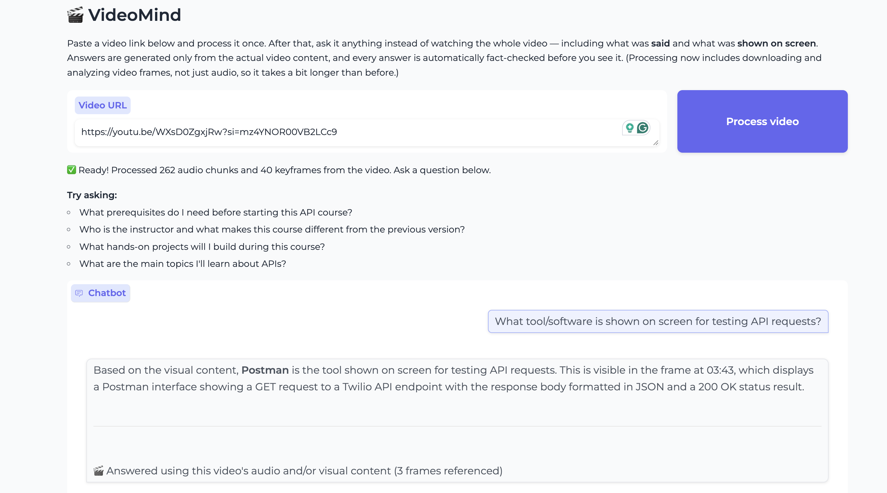

# VideoMind

Ask a long video anything, instead of watching the whole thing.

Paste a YouTube link. VideoMind downloads it, transcribes the audio, extracts and describes
keyframes from the video itself, and lets you chat with the result — asking specific questions,
getting summaries, and following up naturally — with every answer automatically fact-checked
against the actual source material before you see it.

**Live demo:** https://videomind-rt74.onrender.com — runs the real question-answering pipeline
(routing, retrieval, answer, fact-check) on a pre-processed video. It's on a free tier, so the
first load after idle can take about a minute, and it has a daily question cap to protect API
costs. It serves pre-processed videos because free hosting can't run Whisper/OpenCV and YouTube
blocks cloud servers from downloading. To analyze any YouTube link, run the full app locally
(see Setup).

**Evaluated:** a small automated suite (`run_evals.py`, 7 cases across 2 videos) currently
passes **7/7**, covering factual retrieval, on-screen (visual) questions, and honest refusal of
unanswerable questions. It is a small, keyword-based regression check, not a benchmark; see
Known limitations.



## What it does

- **Understands both audio and visuals** — not just what was said, but what was shown on screen
  (UI panels, tables, slides, diagrams)
- **Answers grounded in the source** — every answer is checked against the transcript/keyframes
  it was generated from, and auto-corrected if something doesn't hold up. If the checker itself
  fails, the answer is labeled "unchecked" rather than shown as verified
- **Handles long videos** — transcription uses Groq's hosted Whisper in 20-minute chunks, and
  visual analysis scales with actual on-screen change (scene detection, capped at 40 keyframes),
  not with video length
- **Remembers context** — follow-up questions ("why does that happen?") are understood in
  context, not treated as standalone
- **Routes intelligently** — a LangGraph agent decides per-question whether to pull from audio,
  visual content, or both, and synthesizes a single coherent answer

## Architecture

````
YouTube link
     │
     ├─► yt-dlp (audio) ─► Groq/faster-whisper (transcribe) ─► chunk ─┐
     │                                                                │
     └─► yt-dlp (video) ─► OpenCV (scene-change keyframes)            │
                                  ─► Claude vision (describe)         │
                                  ─► verify + auto-correct ───────────┤
                                                                       ▼
                                                    sentence-transformers (embed)
                                                                       │
                                                                       ▼
                                                          ChromaDB (2 collections:
                                                          audio chunks, keyframes)
                                                                       │
                                                                       ▼
                                              LangGraph router (audio / visual / both)
                                                                       │
                                                                       ▼
                                                   Claude (generate ─► fact-check ─► correct)
                                                                       │
                                                                       ▼
                                                              Gradio chat UI
````

## Tech stack

Python · Claude (Anthropic API) · Gemini (fallback) · Groq (fast transcription) ·
LangChain · LangGraph · ChromaDB · sentence-transformers · yt-dlp · faster-whisper ·
OpenCV · Gradio · FastAPI · Docker · Render

## Setup

````bash
python3 -m venv venv
source venv/bin/activate
pip install -r requirements.txt
````

Create a `.env` file with your API keys:
````
ANTHROPIC_API_KEY=your-key-here
GROQ_API_KEY=your-key-here       # optional but recommended -- fast transcription
GEMINI_API_KEY=your-key-here     # optional -- free fallback if Anthropic billing has issues
````

Run it:
````bash
python3 app.py
````

## Testing

An automated evaluation suite (`run_evals.py` + `eval_cases.json`) processes multiple videos
and checks answers against known-correct facts, catching regressions before they ship.
Downloaded/processed videos are cached locally after their first run (`eval_cache/`), so repeat
eval runs reuse the cached pipeline output instead of re-hitting YouTube — faster iteration, and
avoids tripping YouTube's bot detection from repeated automated downloads.

````bash
python run_evals.py
````

## Deployment

The hosted demo is a containerized **FastAPI** service (`demo_app.py`) with the Gradio chat UI
mounted at `/`, a JSON endpoint (`POST /api/ask`), and a health check (`GET /health`). It is
built from `Dockerfile.demo` and deployed to Render from `render.yaml`.

Free hosting has about 512 MB of RAM, and YouTube blocks downloads from cloud IPs, so the hosted
build serves videos that were **processed ahead of time** (`build_demo_data.py`) and embeds only
the user's question at runtime, using the same MiniLM model through ONNX (`fastembed`) instead of
PyTorch. The full pipeline (download, transcribe, keyframes, vision) runs locally, unchanged.
A daily question cap (`DAILY_QUESTION_LIMIT`) keeps API costs bounded.

````bash
docker build -f Dockerfile.demo -t videomind-demo .
docker run -p 7860:7860 -e ANTHROPIC_API_KEY=your-key videomind-demo
````

## Known limitations

- **Small on-screen text at low source resolution.** YouTube's current streaming restrictions
  cap some videos at 360p, which can make small UI text (a dropdown's selected value, a
  truncated tab label) too small for the vision model to read confidently, even after 2x
  upscaling. The intended behavior is to say it can't read the value rather than guess.
- **Semantic retrieval can miss brief, passing mentions.** A topic mentioned once in a chunk
  that's mostly about something else can be missed by top-k retrieval if the question is phrased
  very differently from the surrounding context (k=8 mitigates this, it doesn't eliminate it).
  If retrieval misses, a wrong answer can still pass the fact-check.
- **The fact-check is an LLM checking an LLM.** It catches many errors, but it uses the same
  model family as the answerer, so shared blind spots are possible.
- **The eval suite is small and keyword-based.** 7/7 is a regression check on two videos, not
  proof of general accuracy.
- **Hosted demo shares state.** The selected video is global to the server, so simultaneous
  visitors switching videos can affect each other (the demo currently ships with one video).

## Real engineering challenges solved along the way

- **YouTube's SABR streaming restriction** breaking format extraction — worked around with
  client fallback strategies
- **Vision hallucination on low-resolution source video** — caught by a dedicated visual
  verification/correction pass, improved further with frame upscaling
- **Stale vector store connections** after processing a new video — fixed with explicit
  retriever refresh logic
- **LLM classification non-determinism** — the same question could be routed differently
  across separate calls; fixed with a dedicated temperature=0 classifier model (which falls back
  to a plain call if the API rejects the parameter, as happened on the hosted build)
- **Keyframe extraction scaling** — fixed-interval sampling grows with video length (and so does
  the number of vision API calls); replaced with scene-change detection and a 40-frame cap
- **Fact-check design** — the checker sees the whole video context when it fits, receives the
  user's exact wording (so a false premise like "the farthest school" isn't silently rewritten
  by the question-rewriter), and a failed check is shown as "unchecked", never as verified
- **Fitting a free host** — replaced PyTorch + ChromaDB with precomputed vectors, ONNX query
  embedding and numpy search for the hosted demo, to stay within ~512 MB of RAM
````
````